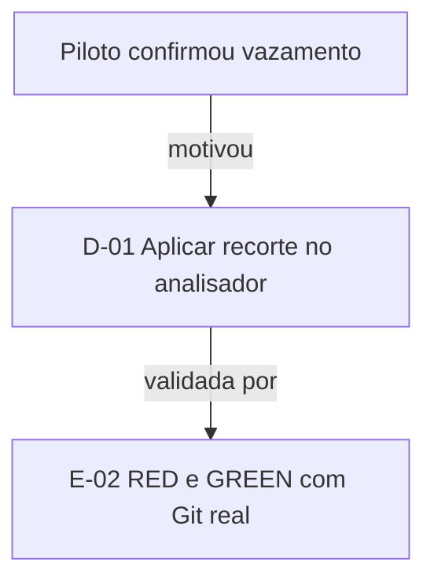

# Decisões históricas do recorte de diff

Fotografia: 20261107-crg-diff-recorte. Revisão: 603bdd2 + [patch preservado](../receipts/crg-diff-recorte/produto.patch). Observado em 2026-11-07 no Windows. Escopo: bug de changed_files. Owner: mantenedor do CRG. Fora: descoberta de fluxos e reindexação do banco instalado.

| ID | Data | Decisão/evento, origem e efeito |
| --- | --- | --- |
| E-01 | 2026-11-07 | Piloto isolou a origem em d007bc1. Fonte: memória CRG-DIFF-RECORTE-VAZA. |
| D-01 | 2026-11-07 | GO do usuário aceita a seleção no analisador compartilhado, preservando o fallback sem faixas. Owner da execução e retomada: mantenedor, no corte do Trilho. [Trilho](../PLAN-TASKS/2026-11-07-crg-diff-recorte.md) |
| E-02 | 2026-11-07 | Duas falhas esperadas antes da correção; mesmas asserções verdes depois e 38 testes na suíte focada. [RED](../receipts/crg-diff-recorte/red.txt) · [Suite](../receipts/crg-diff-recorte/suite.txt) |

| Decisão | Estado | P/P/I/R/T/V | Aceite |
| --- | --- | --- | --- |
| D-01 | Aceita | ✓ E-01 / ✓ Trilho / ✓ patch / ✓ revisão PPIRTV / ✓ E-02 / ✓ três provas vinculadas | 3/3, 100% ██████████ no corte local. Deploy do MCP fora do recorte. |

Funil da coorte D-01: cada etapa local alcançada 1/1. Atestação oficial de fechamento pertence ao flow, não a esta fotografia.
